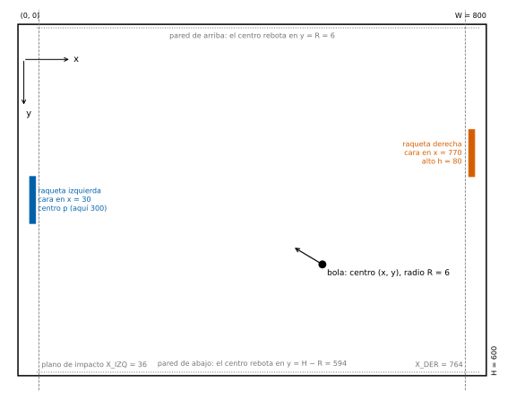

Aquest document recull, en ordre alfabètic, els termes i els símbols que fan servir l'[enunciat de la pràctica](practica.qmd), el teu bot (`src/pong/bot.py`) i el notebook d'anàlisi (`notebook/analisis_mo.py`). Cada entrada diu què significa el terme, com apareix al codi i on s'utilitza. Quan una paraula de l'enunciat tingui aquí la seva definició, l'enllaç et portarà fins aquí.

::: {.callout-important title="L'essencial en una frase"}
Una **partida** es juga a sets; cada **set**, a punts; cada punt es disputa en un **intercanvi**; un intercanvi es compon de diversos **vols**, un per cop més el que surt del servei; i tot avança en **ticks**. La jerarquia és: partida → sets → intercanvis → vols → ticks.
:::

---

## Símbols i constants {#simbolos}

Totes les longituds són en píxels (px) i el temps, en ticks. L'origen del camp és a la cantonada superior esquerra i l'eix $y$ **creix cap avall**. Les constants no cal escriure-les a mà: el teu bot les rep a `state["field"]` i el notebook les té a la seva primera cel·la.

| Símbol | Significat | Valor | A `state["field"]` | Al notebook |
| :--- | :--- | :--- | :--- | :--- |
| $W$ | Amplada del camp | 800 | `width` | — |
| $H$ | Alçada del camp | 600 | `height` | `H` |
| $R$ | Radi de la bola | 6 | `ball_radius` | `R` |
| $L$ | Recorregut vertical del centre de la bola: $H - 2R$ | 588 | — | `L` |
| $h$ | Alçada de la raqueta | 80 | `paddle_height` | — |
| — | Gruix de la raqueta | 10 | `paddle_thickness` | — |
| $X_L$ | Cara frontal de la raqueta esquerra | 30 | `my_face_x` | — |
| $X_R$ | Cara frontal de la raqueta dreta | 770 | `opp_face_x` | — |
| $X_{\text{izq}}$, $X_{\text{der}}$ | [Plans d'impacte](#plano-de-impacto): $X_L + R$ i $X_R - R$ | 36 i 764 | — | `X_IZQ`, `X_DER` |
| $h/2 + R$ | Semiamplada de la [franja d'impacte](#alcance) | 46 | — | `ALCANCE` |
| $v_p$ | Velocitat de la raqueta | 8 px/tick | `paddle_speed` | — |
| $s_0$ | [Velocitat d'intercanvi](#velocidad-de-intercambio) en el servei | 6 px/tick | `initial_speed` | — |
| $m_{\max}$, $m_{\min}$ | Pendents màxim i mínim de sortida d'un cop ($\tan 60°$ i $\tan 5°$) | 1,7321 i 0,0875 | `slope_max`, `slope_min` | — |
| — | Acceleració per cop i velocitat extra als extrems | 1,05 i 0,05 | `speedup`, `edge_speedup` | — |
| $\kappa$ | Constant de l'[efecte](#efecto) | 0,005 px/tick² | `spin_kappa` | `KAPPA` |
| — | Durada de la [pausa del servei](#pausa-del-saque) | 60 ticks | `serve_pause` | — |
| $R_{\max}$ | Cops que anul·len un intercanvi ([nul](#nulo)) | 100 | `max_rally_hits` | — |
| — | Nuls que acaben la partida en [empat tècnic](#empate-tecnico) | 20 | `max_lets` | — |

Altres símbols que fan servir l'enunciat i el notebook:

| Símbol | Significat | Entrada |
| :--- | :--- | :--- |
| $x_n$, $y_n$ | Posició del centre de la bola al final del tick $n$; $y_n$ és l'ordenada **plegada** | [Ordenada plegada i desplegada](#ordenada-plegada-y-desplegada) |
| $Y_n$ | Ordenada **desplegada** al final del tick $n$ d'un vol | [Ordenada plegada i desplegada](#ordenada-plegada-y-desplegada) |
| $F$ | Ona triangular que plega $Y$ en $y$ | [Ona triangular](#onda-triangular) |
| $p$ | Posició (ordenada del centre) d'una raqueta | [Raqueta](#raqueta) |
| $c$ | Ordre: $-1$ (`UP`), $0$ (`STAY`), $+1$ (`DOWN`) | [Ordre](#comando) |
| $v_{x,n}$, $v_{y,n}$ | Components de la velocitat de la bola al final del tick $n$ | [Velocitat de la bola](#velocidad-de-la-bola) |
| $a_{x,n}$, $a_{y,n}$ | Components de l'acceleració: $a_{x,n} = 0$ per a tot $n$; $a_{y,n}$ és l'efecte | [Efecte](#efecto) |
| $v_{x,0}$, $v_{y,0}$, $a_{y,0}$ | Velocitat i efecte en començar un vol ($n = 0$) | [Vol](#vuelo) |
| $\Delta y_n$, $\Delta Y_n$ | Diferències entre ticks consecutius: $y_n - y_{n-1}$ i $Y_n - Y_{n-1}$ | [Velocitat de la bola](#velocidad-de-la-bola) |
| $s$ | Velocitat d'intercanvi | [Velocitat d'intercanvi](#velocidad-de-intercambio) |
| $n$ | Índex de tick: a les lleis del moviment, qualsevol tick en joc; a les fórmules d'un vol, els ticks des del seu inici | [Vol](#vuelo) |
| $y^*$ | Ordenada d'impacte | [Ordenada d'impacte](#ordenada-de-impacto) |
| $u$ | Punt d'impacte relatiu a la raqueta | [Punt d'impacte](#punto-de-impacto) |
| $m$ | Pendent de sortida d'un cop o del servei, $v_{y,0} / |v_{x,0}|$ | [Pendent de sortida](#pendiente-de-salida) |
| $n^*$, $\tau$ | Tick del creuament amb el pla d'impacte i fracció del tick en què passa | [Pla d'impacte](#plano-de-impacto) |
| $k$ | Paritat del nombre de rebots ($0$ o $1$) | [Rebot](#rebote) |

---

## Termes {#terminos}

### Abandonament {#abandono}

Partida que no s'arriba a jugar perquè el constructor `Bot(seed)` d'un dels bots llança una excepció. Compta com a derrota d'aquest bot, amb 0 punts. Al registre JSON, la clau `abandono` indica el costat del bot que ha fallat; el registre no té ticks ni intercanvis. El teu notebook ha de funcionar també amb una partida així: en tens una a `notebook/raras/abandono.json`.

*S'utilitza a:* [normes del bot](practica.qmd#normas-bot), [registres](practica.qmd#registros), notebook (L1).

### Abast (franja d'impacte) {#alcance}

La raqueta retorna la bola si, quan el centre de la bola creua el [pla d'impacte](#plano-de-impacto), la seva [ordenada d'impacte](#ordenada-de-impacto) $y^*$ compleix $|y^* - p| \le h/2 + R = 46$. Aquest interval de 92 px centrat a la raqueta és la franja d'impacte, i 46 és la seva semiamplada, `ALCANCE` al notebook. Els extrems de la raqueta no fan rebotar la bola: fora de la franja, el punt es perd.

*S'utilitza a:* [cop](practica.qmd#golpe), notebook (P3).

### Bot {#bot}

Programa que juga un dels costats de la partida: una classe `Bot` amb un constructor `Bot(seed)` i un mètode `decide(state)` que, a cada [tick](#tick), rep l'[estat](#estado-del-bot) i retorna una [ordre](#comando). El teu és a `src/pong/bot.py`. El mateix objecte `Bot` dura tota la partida, així que pot recordar el que ha vist als seus atributs.

*S'utilitza a:* [el teu bot](practica.qmd#bot).

### Bots de referència {#bots-de-referencia}

Els tres rivals contra els quals es mesura el [rendiment](practica.qmd#rendimiento) del teu bot: **Fàcil** (`easy`), **Mitjà** (`medium`) i **Difícil** (`hard`). Fàcil té el codi a la vista a `src/pong/bots_ref/easy.py`; Mitjà i Difícil es distribueixen compilats.

*S'utilitza a:* [bots de referència](practica.qmd#referencia), [avaluació](practica.qmd#rendimiento).

### Colpejador {#golpeador}

El bot que fa un cop, és a dir, el [receptor](#receptor) del vol que s'acaba. Al notebook, columna `golpeador` de `golpes(d)`.

*S'utilitza a:* notebook (S2, S3).

### Cop {#golpe}

Contacte de la bola amb una raqueta: la bola creua el [pla d'impacte](#plano-de-impacto) dins de la [franja d'impacte](#alcance). El motor la deixa exactament al pla, a l'[ordenada d'impacte](#ordenada-de-impacto), descarta la resta d'aquell tick i la llança de tornada amb un nou [pendent](#pendiente-de-salida), una [velocitat d'intercanvi](#velocidad-de-intercambio) més gran i un [efecte](#efecto). Cada cop incrementa `rally_hits`, i així és com es detecta a l'estat i al CSV.

*S'utilitza a:* [cop](practica.qmd#golpe), notebook (L4, P3, S2, S3).

### CSV de la partida (CSV observable) {#csv}

Fitxer `partida_<semilla>.csv` amb una fila per tick i el mateix que veuen els bots: `tick`, `state`, `ball_x`, `ball_y`, `p_left`, `p_right`, `cmd_left`, `cmd_right`, `server` i `rally_hits`. Fa servir coordenades globals, no normalitzades. La fila $t$ és l'estat **abans** d'executar el tick $t$, amb les ordres que s'hi apliquen. No conté velocitats ni efecte: cal estimar-los (vegeu [veritat del motor](#verdad-del-motor)). S'obté de qualsevol [registre JSON](#registro-json) amb `uv run python -m pong.registro <json>`.

*S'utilitza a:* [registres](practica.qmd#registros), notebook (L2).

### Efecte {#efecto}

Acceleració vertical $a_{y,0} = \kappa\,c$ que rep la bola en un cop, amb $\kappa = 0{,}005$ px/tick² i $c$ l'[ordre](#comando) de la raqueta que colpeja en aquell mateix tick (encara que la raqueta sigui al seu topall i no es mogui). `DOWN` corba la bola cap avall, `UP` cap amunt i `STAY` no li dona efecte. Es manté fins al cop següent ($a_{y,n+1} = a_{y,n}$ en un tick normal) i canvia de signe a cada [rebot](#rebote). L'acceleració horitzontal és sempre nul·la, $a_{x,n} = 0$. En un vol de 100 ticks desvia la bola uns 25 px. L'estat no l'inclou: el teu bot l'ha d'estimar. Al notebook s'escriu $a$; a la [veritat del motor](#verdad-del-motor), `ball_ay`.

*S'utilitza a:* [lleis del moviment](practica.qmd#leyes), [cop](practica.qmd#golpe), [estimació cinemàtica](practica.qmd#estimacion), notebook (P1, P2, P4).

### Empat tècnic {#empate-tecnico}

Resultat d'una partida que arriba al [nul](#nulo) número 20 sense acabar. Al registre JSON, `resultado` val `"draw"`.

*S'utilitza a:* [nuls i final de la partida](practica.qmd#nulos).

### Errada {#fallo}

Final d'un vol en què la bola creua el [pla d'impacte](#plano-de-impacto) fora de la [franja d'impacte](#alcance): el [receptor](#receptor) perd el punt. A la taula de vols del notebook, `final == "fallo"`. Un intercanvi acabat en punt acaba sempre en una errada.

*S'utilitza a:* notebook (L4, P3, S4, S5).

### Estat del bot (`state`) {#estado-del-bot}

Diccionari que rep `decide` a cada tick, amb la situació **a l'inici** d'aquell tick, **normalitzada**: cada bot es veu sempre al costat esquerre, amb la cara frontal de la seva raqueta a $x = 30$. Per al bot dret, el motor transforma $x \to W - x$; $y$ no canvia. Així, la bola s'acosta a la teva raqueta quan `ball_x` decreix. Les seves claus són a l'[enunciat](practica.qmd#estado). No inclou velocitats ni efecte.

*S'utilitza a:* [el teu bot](practica.qmd#estado).

### Intercanvi {#intercambio}

La disputa d'un punt (al JSON, *rally*). Comença amb la [pausa del servei](#pausa-del-saque) (files `serving` del CSV) i acaba quan es decideix el punt (una [errada](#fallo)) o es declara [nul](#nulo). Es compon de diversos [vols](#vuelo): un per cop més l'inicial des del servei, és a dir, `hits + 1` vols si acaba en punt i `hits` si és nul. Al registre JSON, cada intercanvi té `start_tick` (primer tick de la pausa del servei), `end_tick` (tick en què es decideix el punt o es declara el nul), `hits`, `outcome` (`"point"` o `"let"`) i `winner`.

::: {.callout-note title="Exemple"}
A `notebook/ejemplo.json`, l'intercanvi 1 va del tick 0 al 1936: els ticks 0–59 són la pausa del servei, té 24 cops i, per tant, 25 vols. La partida completa té 27 intercanvis i 716 vols.
:::

*S'utilitza a:* [puntuació](practica.qmd#puntuacion), [registres](practica.qmd#registros), notebook (L1, L3, S1, S6, S8).

### Llavor {#semilla}

Nombre enter que fixa tot l'atzar d'una partida (qui serveix primer i la direcció de cada servei). Mateixa llavor i mateixes ordres donen exactament la mateixa partida en qualsevol ordinador. Cada bot rep a més la seva pròpia llavor a `Bot(seed)` per a un `random.Random` propi, si fa servir atzar. Les llavors de l'avaluació oficial són secretes fins després del lliurament.

*S'utilitza a:* [atzar i reproductibilitat](practica.qmd#azar).

### Motor {#motor}

`src/pong/pong_engine.py`, el mòdul que simula el joc: aplica les ordres, mou la bola, resol rebots i cops i porta el marcador. És el mateix al teu Codespace, a `pong.html` i a l'avaluació oficial. No el modifiquis: un test comprova que no ha canviat.

*S'utilitza a:* [regles del joc](practica.qmd#reglas).

### Nul {#nulo}

Intercanvi anul·lat (al JSON, `outcome == "let"`) perquè arriba a $R_{\max} = 100$ cops. Es declara en el mateix tick del cop número 100, que no obre un vol nou, i es repeteix el servei amb el mateix jugador. Ningú no guanya el punt (`winner` és `null`). En arribar al nul número 20, la partida acaba en [empat tècnic](#empate-tecnico). A la pràctica són molt rars; en tens una partida amb un a `notebook/raras/nulo.json`.

*S'utilitza a:* [nuls i final de la partida](practica.qmd#nulos), notebook (L1, L3, L4).

### Ona triangular {#onda-triangular}

La funció $F$ que plega l'[ordenada desplegada](#ordenada-plegada-y-desplegada) $Y$ en la plegada $y$. Amb $m = (Y - R) \bmod 2L$:

$$
F(Y) = \begin{cases} R + m & \text{si } m \le L,\\ R + 2L - m & \text{si } m > L. \end{cases}
$$

La seva gràfica és una ziga-zaga: puja amb pendent 1 de $R$ a $R + L$, baixa amb pendent $-1$ i es repeteix amb **període** $2L = 1176$, és a dir, $F(Y + 2L) = F(Y)$. Sempre pren valors a $[R, H - R] = [6, 594]$. Dins del camp, $F(Y) = Y$; cada pic o vall és un [rebot](#rebote). $F$ no és injectiva: cada $y$ prové d'infinites $Y$. El motor l'aplica a cada tick (`pe.fold`) a l'ordenada acabada d'avançar, sense cercar abans els rebots, i al notebook la programes com a `plegar`.

{fig-alt="Gràfica en ziga-zaga de l'ordenada plegada, amb l'eix vertical cap avall entre 6 i 594 px, respecte de la desplegada, amb període 1176 px; marca els punts F(−100) = 112, F(300) = 300, F(700) = 488 i F(1300) = 124." width="100%"}

::: {.callout-note title="Exemple"}
$F(300) = 300$ (dins del camp); $F(700) = 488$ (sobrepassa la paret de baix, $y = 594$, en 106 i rebota a $594 - 106$); $F(1300) = 124$ (rebota a baix i a dalt); $F(-100) = 112$ (sobrepassa la paret de dalt en 106 i rebota a $6 + 106$).
:::

*S'utilitza a:* [parets i plegament](practica.qmd#paredes), notebook (P2).

### Ordenada d'impacte {#ordenada-de-impacto}

$y^*$: l'ordenada del centre de la bola en l'instant en què creua el [pla d'impacte](#plano-de-impacto), calculada pel motor amb la fracció exacta del tick. Si hi ha cop, la bola queda en aquest punt i és la primera fila del vol següent ($y_0 = y^*$). Si hi ha errada, no apareix al CSV.

*S'utilitza a:* [cop](practica.qmd#golpe), notebook (P3, S4).

### Ordenada plegada i desplegada {#ordenada-plegada-y-desplegada}

- **Plegada**, $y$ ($y_n$ al final del tick $n$): l'ordenada real del centre de la bola, sempre a $[R, H - R]$. És `ball_y` a l'estat del bot i al CSV. És l'única que s'observa.
- **Desplegada**, $Y$ ($Y_n$ al final del tick $n$ d'un vol): la que tindria la bola en un vol si les parets no la reflectissin i seguís la seva trajectòria, encara que sortís del camp. Dins d'un vol és una paràbola, $Y_n = y_0 + n\,v_{y,0} + a_{y,0}\,n(n+1)/2$, i la plegada és $y_n = F(Y_n)$. No és a cap fitxer i el motor tampoc la desa: avança tick a tick la plegada i, a cada rebot, canvia el signe de $v_{y,n}$ i d'$a_{y,n}$, cosa que dona el mateix resultat. Es reconstrueix a partir de la plegada (`desplegar` al notebook).

Desplegar només té sentit **dins d'un vol**: cada cop canvia $v_{y,0}$ i $a_{y,0}$, així que no hi ha una $Y$ comuna a dos vols.

*S'utilitza a:* [parets i plegament](practica.qmd#paredes), [estimació cinemàtica](practica.qmd#estimacion), notebook (P1, P2, P3, P4).

### Ordre {#comando}

El que retorna `decide` a cada tick: `"UP"` (la raqueta puja 8 px), `"DOWN"` (baixa 8 px) o `"STAY"` (no es mou). A les fórmules s'escriu $c \in \{-1, 0, +1\}$: `UP` és $-1$ perquè l'eix $y$ creix cap avall. Qualsevol altre valor, o una excepció, compta com a `"STAY"`. L'ordre del tick d'un cop decideix a més l'[efecte](#efecto) de la bola. Al CSV, columnes `cmd_left` i `cmd_right`.

*S'utilitza a:* [estats d'una partida i moviments de les raquetes](practica.qmd#tick), [normes del bot](practica.qmd#normas-bot), notebook (S7).

### Paret {#pared}

Cadascuna de les dues vores **horitzontals** del camp, la de dalt i la de baix. La bola hi rebota: el seu centre es reflecteix a $y = R$ i a $y = H - R$. Als costats verticals hi ha les raquetes: allà no hi ha rebot, el vol acaba en [cop](#golpe) o en [errada](#fallo).

*S'utilitza a:* [parets i plegament](practica.qmd#paredes), notebook (P1, P2).

### Partida {#partida}

Enfrontament entre dos bots al millor de 3 [sets](#set). S'identifica per la seva [llavor](#semilla) i queda enregistrada en un [registre JSON](#registro-json). S'acaba quan un bot guanya 2 sets, en [empat tècnic](#empate-tecnico), per [abandonament](#abandono) o per [tall per temps](#corte-por-tiempo).

*S'utilitza a:* [puntuació](practica.qmd#puntuacion).

### Pausa del servei {#pausa-del-saque}

Els 60 ticks en estat `serving` abans de cada servei, amb la bola quieta al centre, $(400, 300)$. Les raquetes es poden moure. Durant la pausa, `serve_ticks_left` val 60, 59, …, 1; després l'estat passa a `playing` i la bola es mou per primera vegada en el tick següent. Forma part de l'intercanvi, però no de cap vol.

*S'utilitza a:* [servei](practica.qmd#saque), notebook (L3).

### Pendent de sortida {#pendiente-de-salida}

$m = v_{y,0} / |v_{x,0}|$, la direcció amb què surt la bola d'un cop o del servei, amb $v_{x,0}$ i $v_{y,0}$ les components de la seva velocitat en començar el vol. Si $m > 0$, la bola surt cap avall. En un cop depèn del [punt d'impacte](#punto-de-impacto): $m(u) = \operatorname{sgn}(u)\,\max(m_{\min},\, m_{\max}\,|u|)$, entre 5° i 60° respecte de l'horitzontal. En el servei és aleatori, entre 20° i 45°.

*S'utilitza a:* [cop](practica.qmd#golpe), [servei](practica.qmd#saque).

### Percentatge de punts {#porcentaje-de-puntos}

La mesura del [rendiment](practica.qmd#rendimiento) del teu bot contra un rival: la mitjana, sobre les partides jugades, de la fracció de punts que guanyes a cadascuna (punts guanyats entre punts jugats). Una partida perduda per abandonament o per tall per temps compta 0.

*S'utilitza a:* [rendiment](practica.qmd#rendimiento).

### Pla d'impacte {#plano-de-impacto}

Recta vertical per la qual passa el **centre** de la bola quan toca la cara frontal d'una raqueta: $x = X_L + R = 36$ a l'esquerra (`X_IZQ`) i $x = X_R - R = 764$ a la dreta (`X_DER`). Com que $v_{x,n} = v_{x,0}$ és constant en un vol, el primer tick amb creuament del pla $X$ és $n^* = \lfloor (X - x_0)/v_{x,0} \rfloor + 1$, en els dos sentits, i la fracció del tick en què creua és $\tau$.

{fig-alt="Esquema del camp de 800 per 600 píxels amb les dues raquetes, la bola, les parets i els plans d'impacte." width="100%"}

*S'utilitza a:* [cop](practica.qmd#golpe), notebook (P3).

### Punt {#punto}

Unitat del marcador d'un [set](#set). El guanya el rival del bot que comet una [errada](#fallo). Cada punt es disputa en un [intercanvi](#intercambio).

*S'utilitza a:* [puntuació](practica.qmd#puntuacion).

### Punt d'impacte {#punto-de-impacto}

$u = (y^* - p)/46 \in [-1, 1]$: on colpeja la bola a la raqueta, relatiu al seu centre. $u = 0$ és el centre, $u = -1$ l'extrem de dalt i $u = 1$ el de baix. Decideix el [pendent de sortida](#pendiente-de-salida) (colpejar amb l'extrem de dalt envia la bola cap amunt amb un angle tancat) i la [velocitat d'intercanvi](#velocidad-de-intercambio) següent. Al notebook, columna `u` de `golpes(d)`.

*S'utilitza a:* [cop](practica.qmd#golpe), notebook (S2, S3).

### Raqueta {#raqueta}

Rectangle de 10 × 80 px a cada costat del camp. La seva posició $p$ és l'ordenada del seu **centre**, amb $p \in [h/2, H - h/2] = [40, 560]$. Es mou 8 px per tick segons l'[ordre](#comando) i s'atura als topalls. Totes dues comencen la partida a $p = 300$. A l'estat, `my_paddle_y` i `opp_paddle_y`; al CSV, `p_left` i `p_right`.

*S'utilitza a:* [camp](practica.qmd#campo), [estats d'una partida i moviments de les raquetes](practica.qmd#tick).

### Rebot {#rebote}

La reflexió de la bola en una [paret](#pared). **No talla el vol**: un vol en pot tenir diversos (a `ejemplo.json`, de 0 a 3). En coordenades plegades, cada rebot inverteix el signe de $v_{y,n}$ i de l'efecte $a_{y,n}$; en l'ordenada desplegada, un rebot és un creuament d'una frontera $R + kL$, amb $k$ enter, i la paritat $k$ del nombre de rebots diu si els signes estan invertits. El **rebot inicial** és el que passa entre les tres primeres observacions d'un vol: obliga a reflectir-les abans d'estimar $v_{y,0}$ i $a_{y,0}$.

*S'utilitza a:* [lleis del moviment](practica.qmd#leyes), [parets i plegament](practica.qmd#paredes), [estimació cinemàtica](practica.qmd#estimacion), notebook (P1, P2, P4).

### Receptor {#receptor}

El bot cap al qual va la bola en un vol: és qui l'ha de retornar. En el servei, el receptor és el rival de qui serveix. A la taula de vols del notebook, columna `receptor`.

*S'utilitza a:* [servei](practica.qmd#saque), notebook (L4, P3, S4).

### Registre JSON {#registro-json}

Fitxer `partida_<semilla>.json` que enregistra una partida completa: versió del motor, llavor, noms dels bots, sets, resultat, `abandono` i `tiempo_excedido`, la llista d'intercanvis i les ordres de cada tick. Amb la llavor i les ordres, el motor reprodueix la partida exactament, així que se n'obtenen el [CSV](#csv) i la [veritat del motor](#verdad-del-motor). Ocupa poc i es puja al repositori.

*S'utilitza a:* [registres](practica.qmd#registros), notebook (L1).

### Servei {#saque}

Inici d'un intercanvi: després de la [pausa del servei](#pausa-del-saque), la bola surt del centre cap al [receptor](#receptor) amb la velocitat inicial $s_0 = 6$ i un pendent aleatori. Serveix qui va guanyar el punt anterior; el primer servei de la partida se sorteja i el dels sets 2 i 3 és per a qui va perdre el set anterior. Al CSV, columna `server`; a l'estat, `serving`.

*S'utilitza a:* [servei](practica.qmd#saque), notebook (S6).

### Set {#set}

Part d'una partida. El guanya el bot que arriba a 11 punts amb 2 d'avantatge; des de 10-10 es juga a avantatge de 2, i a 14-14 el punt següent guanya el set (15-14). La partida és al millor de 3 sets.

*S'utilitza a:* [puntuació](practica.qmd#puntuacion), notebook (S8).

### Tall per temps {#corte-por-tiempo}

Final anticipat d'una partida perquè un bot supera el temps mitjà permès per crida a `decide` (2 ms). Des de la crida 5 000 es vigila la mitjana, i la partida es talla tan bon punt la supera. El bot que la supera perd la partida amb 0 punts. Al registre JSON, la clau `tiempo_excedido` indica el seu costat; la partida s'enregistra fins al tick del tall, i l'intercanvi que estava en joc no figura a la llista d'intercanvis. En tens una partida així a `notebook/raras/tiempo.json`.

*S'utilitza a:* [normes del bot](practica.qmd#normas-bot), notebook (L3).

### Tick {#tick}

La unitat de temps del joc: un pas del motor. A cada tick, els bots decideixen, les raquetes es mouen i la bola avança. Els ticks es numeren des de 0; `state["tick"]` és l'índex del tick que està a punt d'executar-se. La visualització els mostra a 60 per segon, però això no afecta la física. Les velocitats es mesuren en px/tick i l'efecte, en px/tick². No confonguis aquest índex absolut amb l'$n$ de les fórmules d'un vol, que compta els ticks des del seu inici.

*S'utilitza a:* [lleis del moviment](practica.qmd#leyes), [estats d'una partida i moviments de les raquetes](practica.qmd#tick).

### Velocitat de la bola {#velocidad-de-la-bola}

Les seves components al final del tick $n$, $v_{x,n}$ (horitzontal) i $v_{y,n}$ (vertical), en px/tick. A cada tick normal, $v_{x,n+1} = v_{x,n}$ i $v_{y,n+1} = v_{y,n} + a_{y,n}$ ([lleis del moviment](practica.qmd#leyes)). Dins d'un vol, $v_{x,n} = v_{x,0}$ és **constant** i la velocitat vertical canvia per l'efecte: en coordenades desplegades, $\Delta Y_n = Y_n - Y_{n-1} = v_{y,0} + n\,a_{y,0}$; en coordenades plegades, $v_{y,n}$ és aquest valor amb el signe canviat després de cada rebot. L'estat no les inclou: s'estimen amb diferències de posicions successives, que en aquest joc són **exactes** (excepte arrodoniment). Al notebook s'escriuen $v_0$ per $v_{y,0}$ i $v_n$ per $\Delta Y_n$; a la [veritat del motor](#verdad-del-motor), `ball_vx` i `ball_vy`.

*S'utilitza a:* [lleis del moviment](practica.qmd#leyes), [moviment entre cops](practica.qmd#entre-golpes), [estimació cinemàtica](practica.qmd#estimacion), notebook (P1, P4).

### Velocitat d'intercanvi {#velocidad-de-intercambio}

$s$, l'escalar que el motor fixa a cada cop i que determina el mòdul de la velocitat amb què surt la bola: $v_{x,0}$ i $v_{y,0}$ es calculen a partir de $s$ i del [pendent](#pendiente-de-salida). Comença a $s_0 = 6$ a cada servei i a cada cop es multiplica per $1{,}05\,(1 + 0{,}05\,|u|)$, així que creix al llarg de l'intercanvi. Durant un vol no canvia; amb efecte, en canvi, el mòdul real de la velocitat, $\sqrt{v_{x,n}^2 + v_{y,n}^2}$, sí que canvia, perquè canvia $v_{y,n}$. Al notebook s'estima com $\sqrt{v_{x,0}^2 + v_{y,0}^2}$ (columna `s`); a la veritat del motor, `ball_speed`.

*S'utilitza a:* [cop](practica.qmd#golpe), [servei](practica.qmd#saque), notebook (P3, S3, S5).

### Veritat del motor {#verdad-del-motor}

Les magnituds internes del motor que ni els bots ni el CSV veuen, tick a tick: `ball_vx`, `ball_vy`, `ball_ay` i `ball_speed`. S'obtenen rejugant el registre JSON amb `pong.registro.verdad(ruta)` o amb `uv run python -m pong.registro <json> --verdad`. Serveixen per comprovar les teves estimacions, no per jugar.

*S'utilitza a:* [registres](practica.qmd#registros), notebook (P4, `d.verdad`).

### Vol {#vuelo}

El tram de la trajectòria de la bola entre dos cops consecutius, des del servei fins al primer cop o des de l'últim cop fins al final de l'intercanvi. Els [rebots](#rebote) a les parets no el tallen. Al CSV, són les files `playing` consecutives d'un intercanvi amb el mateix `rally_hits`. $n$ compta els ticks des de l'inici del vol: $n = 0$ és la seva primera fila.

- **Primera fila:** en el primer vol d'un intercanvi, la primera fila `playing` després de la pausa del servei, amb la bola al centre; en els altres, la fila del cop, amb la bola al pla d'impacte i `rally_hits` ja incrementat, de manera que $y_0 = y^*$.
- **Última fila:** l'anterior a la del cop següent o, si el vol acaba en errada o nul, l'última fila `playing` de l'intercanvi (`end_tick`); el creuament passa en aquell tick i no apareix al CSV.

Un intercanvi acabat en punt té `hits + 1` vols i un de nul, `hits`. Al notebook, la taula `d.vuelos` (L4) té una fila per vol.

*S'utilitza a:* [moviment entre cops](practica.qmd#entre-golpes), notebook (L4 i gairebé tots els apartats).
