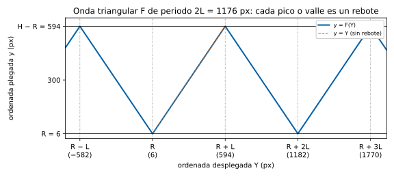

## Introducción

*Pong*, de Atari, fue el primer videojuego con éxito comercial. [Allan Alcorn](https://en.wikipedia.org/wiki/Allan_Alcorn){target="_blank" rel="noopener noreferrer"} lo diseñó en 1972 como ejercicio de práctica que le encargó [Nolan Bushnell](https://en.wikipedia.org/wiki/Nolan_Bushnell){target="_blank" rel="noopener noreferrer"}, inspirado en el tenis de mesa de la consola Magnavox Odyssey; el primer prototipo, un circuito de lógica digital sin software conectado a un televisor en blanco y negro, se instaló en agosto de 1972 en un bar de Sunnyvale, y a finales de 1974 Atari había vendido más de 8 000 máquinas [@wikipedia_pong]. Sus reglas eran sencillas y han llegado casi intactas hasta hoy: 

- cada raqueta estaba dividida en ocho segmentos, de modo que el punto de golpeo decidía el ángulo de salida, 
- la bola se aceleraba a medida que se alargaba el intercambio y recuperaba su velocidad tras cada punto,
- ganaba el primero en llegar a 11 puntos [@edwards2012; @wikipedia_pong]. 

Hay además un detalle curioso: por un defecto del circuito, las raquetas no llegaban al borde superior de la pantalla. Alcorn lo dejó así porque añadía dificultad y acortaba las partidas.

**Importancia.** Se considera el juego que puso en marcha la industria del videojuego. Forma parte de la colección permanente del Smithsonian y entró en el World Video Game Hall of Fame en 2015.

## La Práctica

En esta práctica programarás un **[bot](definiciones.qmd#bot) que juega al Pong** contra otros bots y **analizarás las partidas** que juega tu bot con datos de las mismas. Las reglas del juego las fija un motor escrito en Python que se encuentra en el proyecto (repositorio de GitHub) [**practica-programacion-23200**](https://github.com/UIB-23200-Programacion/practica-programacion-23200){target="_blank" rel="noopener noreferrer"} en la organización de la asignatura. Este motor será el mismo que se ejecuta en tu entorno de trabajo como en la evaluación. Todas las partidas quedan grabadas en registros que podrás estudiar con Pandas, NumPy y Matplotlib. La práctica recorre así casi todo el temario de la asignatura: funciones y módulos, estructuras de datos, algoritmos, tests, clases, ficheros y el ecosistema científico de Python.

El motor de esta práctica (script `src/pong/pong_engine.py` en el proyecto) conserva las reglas del Pong original: 

- el ángulo de salida depende de forma continua del [punto de impacto](definiciones.qmd#punto-de-impacto), 
- cada golpe multiplica la velocidad por un factor fijo,
- los sets se juegan a 11 puntos con ventaja de 2,

pero además, añade el [efecto](definiciones.qmd#efecto), que el original no tenía.

Los términos y símbolos del juego (vuelo, intercambio, ordenada plegada, punto de impacto…) están definidos en el documento [**Definiciones y notación**](definiciones.qmd). Cuando una palabra de este enunciado tenga allí su definición, aparece enlazada.

::: {#imp-entregables .callout-important title="Qué entregas"}
Todo se entrega en **una copia (.zip) de tu repositorio privado** de GitHub que debes crear a partir de la plantilla de la práctica (ver abajo). Se evalúan tres ficheros:

1. **Tu bot**, `src/pong/bot.py` (4,5 puntos).
2. **Tus tests**, `tests/test_bot.py` (1 punto).
3. **Tu notebook de análisis**, `notebook/analisis_mo.py` (4,5 puntos).

La práctica se califica sobre 10 puntos y se aprueba con un **5**, sin mínimos por apartado. Pesa un **30 %** de la nota de la asignatura, con nota de validación 5 (véase la [guía docente](../informaciones/guia-docente.qmd)). 

**Fecha límite: 22 de diciembre de 2026 a las 23:59.**
:::

---

## 1. Puesta en marcha {#puesta-en-marcha}

### **1.1 Tu copia de la plantilla**

La plantilla es el repositorio [`practica-programacion-23200`](https://github.com/UIB-23200-Programacion/practica-programacion-23200){target="_blank" rel="noopener noreferrer"} de la organización de la asignatura. Contiene el motor, los bots de referencia, las herramientas, el esqueleto de tu bot y de tus tests y el notebook de análisis.

1. En la plantilla, pulsa **Use this template → Create a new repository**.
2. Elige visibilidad **Private**. **Es obligatorio**: en un repositorio público tus compañeros verían tu bot antes de la evaluación.

### **1.2 El entorno de trabajo**

Puedes trabajar en **GitHub Codespaces** (recomendado; no hay que instalar nada: **Code → Codespaces → Create codespace on main**) o en tu ordenador con **VS Code, Docker y la extensión *Dev Containers*** (**Reopen in Container**), con la misma configuración. La instalación directa de Python, sin Docker, no está soportada: los bots Medio y Difícil van compilados para los entornos anteriores. Al abrirse el entorno se instalan Python 3.13 y todas las bibliotecas.

El `README.md` de la plantilla explica en detalle cada herramienta. Las órdenes básicas son:

| Qué | Orden |
| :--- | :--- |
| Ejecutar todos los tests | `uv run pytest` |
| Jugar una partida contra Fácil y guardar su registro | `uv run python -m pong.runner --rival easy` |
| Jugar contra tu propio bot | `uv run python -m pong.runner --rival mi_bot` |
| Estimar tu nota de rendimiento contra Difícil | `uv run python -m pong.evaluate --rival hard --partidas 100` |
| Lo mismo, guardando las partidas y un resumen de la peor a la mejor | `uv run python -m pong.evaluate --rival hard --partidas 100 --guardar` |
| Obtener el CSV de una partida guardada | `uv run python -m pong.registro partidas/partida_<semilla>.json` |
| Ver partidas en el navegador (`pong.html`) | `uv run python -m http.server 8000` y abrir `/pong.html` |
| Abrir el notebook de análisis | `uv run marimo edit --no-token notebook/analisis_mo.py` |

Sube a GitHub con frecuencia tu trabajo y los registros de `partidas/`: GitHub borra los Codespaces que llevan tiempo sin usarse.

---

## 2. Reglas del juego {#reglas}

Las reglas las define el [motor](definiciones.qmd#motor), `src/pong/pong_engine.py`. **No lo modifiques**: un test comprueba que no ha cambiado, y la evaluación usa siempre el original. Lo que sigue describe con exactitud lo que hace; ante cualquier duda, el código del motor es la referencia.

### **2.1 Campo y unidades** {#campo}

El campo mide $W \times H = 800 \times 600$ px, con el origen en la esquina superior izquierda y el **eje $y$ creciendo hacia abajo**. El tiempo se mide en [ticks](definiciones.qmd#tick). El tick es una unidad de tiempo discreta y abstracta, un paso de la simulación, sin equivalencia en segundos. Las velocidades se miden en px/tick y el efecto en px/tick².

 de arriba y abajo; a los lados están las raquetas y sus [planos de impacto](definiciones.qmd#plano-de-impacto).](../../images/campo.svg){fig-alt="Esquema del campo de 800 por 600 píxeles con las dos raquetas, la bola, las paredes y los planos de impacto." width="100%"}

La visualización muestra 60 ticks por segundo, pero eso no afecta a la física. Fuera del navegador, las partidas van tan rápido como permite el ordenador. El motor tarda unos 7 µs por tick, así que una partida entera se juega en una fracción de segundo. 

| Elemento | Valor |
| :--- | :--- |
| Bola | Círculo de radio $R = 6$; su centro $(x, y)$ cumple $y \in [R, H - R] = [6, 594]$ |
| [Raquetas](definiciones.qmd#raqueta) | $10 \times 80$ px ($h = 80$). Su posición $p$ es la ordenada de su centro, $p \in [40, 560]$. Empiezan en $p = 300$ |
| Cara frontal de la raqueta izquierda | $x = X_L = 30$ (la raqueta ocupa $x \in [20, 30]$) |
| Cara frontal de la raqueta derecha | $x = X_R = 770$ (ocupa $x \in [770, 780]$) |
| Velocidad de la raqueta | $v_p = 8$ px/tick |
| [Velocidad de intercambio](definiciones.qmd#velocidad-de-intercambio) en el saque | $s_0 = 6$ px/tick |

Todas las constantes, con su nombre en el código, están en la tabla de [símbolos y constantes](definiciones.qmd#simbolos).

### **2.2 Leyes del movimiento de la bola** {#leyes}

Numeramos con $n = 0, 1, 2, \dots$ los ticks en que la bola está en juego. Al final del tick $n$, la bola tiene:

- posición $(x_n, y_n)$, en px: las coordenadas de su centro;
- velocidad $(v_{x,n},\ v_{y,n})$, en px/tick;
- aceleración $(a_{x,n},\ a_{y,n})$, en px/tick². 

La aceleración horizontal es siempre nula, $a_{x,n} = 0$ para todo $n$. La vertical es el [efecto](definiciones.qmd#efecto).

En un tick, primero la velocidad aumenta de acuerdo a la aceleración y después la posición aumenta de acuerdo a la **nueva** velocidad:

$$
\begin{aligned}
v_{x,n+1} &= v_{x,n} + a_{x,n} = v_{x,n}, & \qquad x_{n+1} &= x_n + v_{x,n+1},\\
v_{y,n+1} &= v_{y,n} + a_{y,n}, & \qquad y_{n+1} &= y_n + v_{y,n+1}.
\end{aligned}
$$

La aceleración vertical no cambia en un tick normal: $a_{y,n+1} = a_{y,n}$. Por tanto, en un tick normal solo cambian la velocidad vertical y la posición. Estas igualdades valen en cada tick salvo en tres situaciones, las únicas en las que también puede cambiar la aceleración, que se explican en los apartados siguientes:

- **Rebote en una pared** (apartado [2.4](#paredes)). Si $y_{n+1}$ sale del intervalo $[6, 594]$, la bola se refleja en la pared: vuelve hacia dentro tantos píxeles como se había pasado, y $v_{y,n+1}$ y $a_{y,n+1}$ cambian de signo. $v_{x,n+1}$ no cambia.
- **Cruce con un plano de impacto** (apartado [2.5](#golpe)). La bola queda en el plano y el resto del tick se descarta. Si hay golpe, sale con una velocidad nueva, que depende del [punto de impacto](definiciones.qmd#punto-de-impacto) y es mayor que la anterior, y con efecto $a_{y,n+1} = 0{,}005\,c$, donde $c$ es el comando con que se mueve la raqueta que golpea (apartado [2.3](#tick)). Si no hay golpe, el punto termina.
- **Saque** (apartado [2.7](#saque)). Tras cada punto, la bola vuelve al centro y no se mueve durante la pausa del saque. Después sale hacia el receptor con la velocidad de intercambio $s_0 = 6$, una inclinación aleatoria y sin efecto.

Entre dos golpes, por tanto, la bola se mueve con velocidad horizontal constante y aceleración vertical constante, salvo el cambio de signo en cada rebote. El apartado [2.6](#entre-golpes) da la posición tras $n$ ticks sin tener que recorrerlos uno a uno.

### **2.3 Estados de una partida y movimientos de las raquetas** {#tick}

El motor recorre un ciclo de tres estados visibles. Esos tres estados son por los que pasa una partida: `serving` (pausa del saque), `playing` (bola en juego) y `match_over` (fin). 

Cada raqueta se mueve solo en vertical, en cada tick y según el [comando](definiciones.qmd#comando) de su bot. Los únicos tres comandos que devuelve un bot son `UP`, `STAY` y `DOWN`. El comando:

- `UP` sube la raqueta 8 px, 
- `DOWN` la baja 8 px y 
- `STAY` la deja quieta (en su lugar). 

Sea $c \in \{-1, 0, +1\}$ y hagamos la asociación:

- $c = -1$ para `UP`, 
- $c = 0$ para `STAY` y 
- $c = 1$ para `DOWN`. 

Sea $p$ la ordenada del centro de la raqueta en píxeles, entonces la fórmula para el movimiento de $p$ en un comando es:  

$$
p \leftarrow \min(\max(p + 8c,\ 40),\ 560).
$$

Observa que `UP` es $-1$ porque el eje $y$ crece hacia abajo, subir es restar. No hay inercia ni aceleración: se mueve a velocidad fija o se para en el acto, y se detiene en los topes, $p = 40$ arriba y $p = 560$ abajo. Las dos raquetas empiezan la partida en $p = 300$, y el motor no las recoloca nunca: ni tras un punto ni al empezar un set. Es decir, después de empezada una partida las raquetas solo se mueven por comandos del bot respectivo.

En estado `playing`, para cada tick se ejecutan los siguientes pasos, en este orden:

1. Cada bot recibe el [estado](#estado) al **inicio** del tick y devuelve su comando (internamente se convierte a $c$).
2. Cada raqueta se mueve: $p \leftarrow \min(\max(p + 8c,\ 40),\ 560)$.
3. El [efecto](definiciones.qmd#efecto) cambia la velocidad vertical: $v_y \leftarrow v_y + a_y$.
4. La bola avanza en línea recta: $x \leftarrow x + v_x$, $y \leftarrow y + v_y$, sin tener en cuenta las paredes por ahora.
5. Si en ese avance el borde de la bola alcanza la cara frontal de la raqueta hacia la que va, se resuelve el **cruce** (apartado [2.5](#golpe)): golpe o punto perdido. El resto del tick se descarta.
6. Si no, la ordenada se **pliega** sobre el campo (apartado [2.4](#paredes)), lo que resuelve todos los rebotes del tick.

Los pasos 3 y 4 son las leyes del apartado [2.2](#leyes) escritas como asignaciones, sin índices: el motor guarda un solo valor de cada magnitud y lo sustituye por el nuevo.

Durante la [pausa del saque](definiciones.qmd#pausa-del-saque), en estado `serving`, solo se ejecutan los pasos 1 y 2: las raquetas se mueven, la bola no.

### **2.4 Paredes y plegado** {#paredes}

La bola rebota en las [paredes](definiciones.qmd#pared) de arriba y abajo como la luz en un espejo: al chocar, la componente vertical de su velocidad cambia de signo y la horizontal no cambia. Para explicar cómo el motor implementa los rebotes necesitamos dos ordenadas $y$ e $Y$:

- **$y$, la [ordenada plegada](definiciones.qmd#ordenada-plegada-y-desplegada).** Es la ordenada real del centro de la bola en coordenadas de pantalla. Es `ball_y` en el estado (`state`) y en el CSV. La bola tiene radio $R = 6$ y no puede atravesar las paredes, así que su centro está siempre en $[R,\ H - R] = [6, 594]$. Ese intervalo mide $L = H - 2R = 588$ px.
- **$Y$, la [ordenada desplegada](definiciones.qmd#ordenada-plegada-y-desplegada).** Dentro de un [vuelo](definiciones.qmd#vuelo), es la ordenada que tendría el centro de la bola si las paredes no existieran y siguiera el mismo movimiento, con la misma velocidad vertical y el mismo efecto. Puede salir del campo y tomar cualquier valor real. Al empezar el vuelo, las dos coinciden: $Y_0 = y_0$. La ordenada $Y$ no se observa ni el motor la guarda: es una herramienta matemática para describir y predecir el movimiento.

Las dos se relacionan mediante una función $F$, la [onda triangular](definiciones.qmd#onda-triangular): $y = F(Y)$. Más abajo damos su fórmula; primero, la idea.

**Qué hace el motor en cada tick.** El motor no busca los rebotes. En el paso 4 del tick (apartado [2.3](#tick)) avanza la bola sin tener en cuenta las paredes, y en el paso 6 **pliega** la ordenada obtenida:

- Si ha quedado dentro de $[6, 594]$, la deja como está.
- Si ha quedado fuera, la refleja en la pared que ha sobrepasado: la bola vuelve hacia dentro tantos píxeles como se había pasado. Además, $v_y$ y el efecto $a_y$ cambian de signo.

Dentro de un tick la bola avanza en línea recta, así que reflejar el punto final da exactamente la posición que tendría la bola tras rebotar a mitad del tick.

::: {.callout-note title="Ejemplo 1: un rebote sin efecto"}
La bola está en $y = 580$, baja con $v_y = 10$ y no tiene efecto ($a_y = 0$).

| Tick | Avance sin paredes | ¿Fuera? | $y$ tras plegar | $v_y$ |
|---|---|---|---|---|
| 1 | $580 + 10 = 590$ | no | $590$ | $10$ |
| 2 | $590 + 10 = 600$ | se pasa 6 de 594 | $594 - 6 = 588$ | $-10$ |
| 3 | $588 - 10 = 578$ | no | $578$ | $-10$ |

Si no hubiera pared, la bola seguiría bajando: $Y = 590, 600, 610$. Las ordenadas reales son el reflejo de esas en la pared $y = 594$: $600 \mapsto 588$ y $610 \mapsto 578$. Es decir, $y = F(Y)$.
:::

**La onda triangular $F$.** Imagina el campo como un pasillo de espejos: encima y debajo del campo real hay copias de altura $L$, cada una reflejada respecto de la anterior. La bola desplegada se mueve por ese pasillo sin chocar con nada. La bola real es su imagen en el campo original: si está en una copia par, basta trasladarla; si está en una impar, hay que reflejarla. Con $m = (Y - R) \bmod 2L$, esto es

$$
F(Y) = \begin{cases} R + m & \text{si } m \le L,\\ R + 2L - m & \text{si } m > L, \end{cases}
$$

una función en zigzag de periodo $2L = 1176$ con valores en $[6, 594]$. Sus picos y valles son los rebotes.

{fig-alt="Gráfica en zigzag de la ordenada plegada frente a la desplegada, entre 6 y 594 px, con periodo 1176 px y cuatro puntos de ejemplo." width="100%"}

**Por qué también cambia de signo el efecto.** Si en un tick hay un rebote, el motor cambia el signo de $v_y$, como en un espejo, y **también el de $a_y$**. Esto último no es física realista: es una decisión de diseño. Con ella, la bola real es en cada tick el reflejo de la desplegada, y la desplegada sigue sin interrupciones el mismo movimiento de antes del rebote.

::: {.callout-note title="Ejemplo 2: un rebote con efecto"}
La bola está en $y = 580$, con $v_y = 6$ y un efecto exagerado, $a_y = 1$, para que se vea (en el motor, $|a_y| \le 0{,}005$). Recuerda que en cada tick primero $v_y \leftarrow v_y + a_y$ y después la bola avanza (apartado [2.2](#leyes)).

| Tick | $Y$ (sin paredes) | $F(Y)$ | $y$ del motor | $y$ si $a_y$ no cambiara de signo |
|---|---|---|---|---|
| 1 | $587$ | $587$ | $587$ | $587$ |
| 2 | $595$ | $593$ | $593$ (rebote) | $593$ (rebote) |
| 3 | $604$ | $584$ | $584$ | $586$ |
| 4 | $614$ | $574$ | $574$ | $580$ |
| 5 | $625$ | $563$ | $563$ | $575$ |

El motor reproduce exactamente $F(Y)$ en cada tick. Si $a_y$ no cambiara de signo, el efecto, que antes empujaba la bola hacia abajo, la seguiría empujando hacia abajo tras rebotar. La bola real dejaría de ser el reflejo de la desplegada, y habría que calcular cada rebote por separado.
:::

**La consecuencia, y por qué importa.** Gracias a esta regla, todo un vuelo, con todos sus rebotes, se describe con **una sola** curva desplegada $Y_n$ (apartado [2.6](#entre-golpes)), y la bola real es $y_n = F(Y_n)$. Para predecir dónde estará la bola dentro de muchos ticks no hace falta simular rebote a rebote: basta calcular $Y_n$ y plegarlo una vez. Al revés, para estimar la velocidad a partir de lo que observas, primero hay que **desplegar** las observaciones (apartado [3.3](#estimacion)).

Las dos formas de calcular coinciden en exactas matemáticas; en coma flotante difieren en un error de redondeo despreciable, que no cambia ninguna decisión.

### **2.5 El golpe** {#golpe}

Cuando el centro de la bola cruza el [plano de impacto](definiciones.qmd#plano-de-impacto) de la raqueta que recibe ($x = 36$ a la izquierda, $x = 764$ a la derecha), el motor calcula con la fracción exacta del tick la [ordenada de impacto](definiciones.qmd#ordenada-de-impacto) $y^*$.

- Si $|y^* - p| \le h/2 + R = 46$ (la [franja de impacto](definiciones.qmd#alcance)), hay **golpe**. La bola queda exactamente en el plano, a la altura $y^*$, el resto del tick se descarta y el contador `rally_hits` aumenta en 1.
- Si no, el receptor **pierde el punto**. Los extremos de la raqueta no rebotan la bola.

En un golpe, el [punto de impacto](definiciones.qmd#punto-de-impacto) $u = (y^* - p)/46 \in [-1, 1]$ decide la salida ($u = 0$ es el centro de la raqueta, $u = -1$ el extremo de arriba y $u = 1$ el de abajo):

- **Pendiente de salida** $m = v_{y,0}/|v_{x,0}|$, donde $v_{x,0}$ y $v_{y,0}$ son las componentes de la velocidad con que sale la bola, al empezar el [vuelo](definiciones.qmd#vuelo) nuevo: $m(u) = \operatorname{sgn}(u)\,\max(m_{\min},\ m_{\max}\,|u|)$, con $m_{\max} = \tan 60°$ y $m_{\min} = \tan 5°$. Golpear con el centro devuelve la bola casi horizontal; con los extremos, con un ángulo cerrado hacia ese lado. Si $u = 0$ exactamente, el signo se sortea.
- **Velocidad**: la [velocidad de intercambio](definiciones.qmd#velocidad-de-intercambio) $s$ se multiplica por $1{,}05\,(1 + 0{,}05\,|u|)$: cada golpe acelera la bola, y más si se golpea con el extremo. Después, $v_{x,0} = \pm s/\sqrt{1 + m^2}$ (hacia el rival) y $v_{y,0} = s\,m/\sqrt{1 + m^2}$.
- **Efecto**: $a_{y,0} = \kappa\,c$, con $\kappa = 0{,}005$ px/tick² y $c$ el comando de la raqueta que golpea **en ese mismo tick**. `DOWN` curva la bola hacia abajo, `UP` hacia arriba y `STAY` no la curva. Se mantiene hasta el golpe siguiente, salvo el signo, que cambia en cada rebote.

### **2.6 Movimiento entre golpes** {#entre-golpes}

Entre dos golpes, en un [vuelo](definiciones.qmd#vuelo), contamos los ticks desde su inicio: $n = 0$ es la primera posición del vuelo, con velocidad $(v_{x,0}, v_{y,0})$ y efecto $a_{y,0}$. Aplicando $n$ veces las leyes del apartado [2.2](#leyes) y desplegando los rebotes (apartado [2.4](#paredes)), la bola cumple exactamente, tras $n$ ticks completos:

$$
x_n = x_0 + n\,v_{x,0}, \qquad Y_n = y_0 + n\,v_{y,0} + a_{y,0}\,\frac{n(n+1)}{2}, \qquad y_n = F(Y_n).
$$

Es decir, $v_{x,n} = v_{x,0}$ es constante y la velocidad vertical desplegada crece en $a_{y,0}$ cada tick: $Y_n - Y_{n-1} = v_{y,0} + n\,a_{y,0}$. En coordenadas plegadas, $v_{y,n}$ y $a_{y,n}$ son estos mismos valores con el signo cambiado tras cada rebote. Fíjate en que es la fórmula **discreta**, no la continua $y_0 + v_{y,0}\,t + \tfrac12 a_{y,0}\,t^2$, que comete un error de $a_{y,0}\,n/2$: el $n(n+1)/2$ sale de que la posición avanza con la velocidad **nueva**.

### **2.7 Saque** {#saque}

Antes de cada saque (al empezar la partida y cada set, y tras cada punto o nulo) hay una **pausa de 60 ticks** en estado `serving`: la bola está quieta en el centro, $(400, 300)$, y las raquetas se pueden mover (no se recolocan). Después:

- La bola sale del centro hacia el [receptor](definiciones.qmd#receptor), el rival de quien saca, con la [velocidad de intercambio](definiciones.qmd#velocidad-de-intercambio) $s_0 = 6$, sin efecto ($a_{y,0} = 0$) y con `rally_hits` a 0.
- La pendiente $m$ se sortea entre $\tan 20°$ y $\tan 45°$, y también si va hacia arriba o hacia abajo.
- **Quién saca**: el primer saque de la partida se sortea. Después saca quien gana el punto. El primer saque de los sets 2 y 3 es para quien perdió el set anterior.

Las componentes de la velocidad de salida se calculan con las mismas fórmulas que en un golpe (apartado [2.5](#golpe)), con $s = s_0$:

$$
v_{x,0} = \pm\frac{s_0}{\sqrt{1+m^2}}, \qquad v_{y,0} = \frac{s_0\,m}{\sqrt{1+m^2}}, \qquad \sqrt{v_{x,0}^2 + v_{y,0}^2} = s_0,
$$

con el signo de $v_{x,0}$ hacia el receptor. Como $|m|$ está entre $\tan 20°$ y $\tan 45°$, $|v_{y,0}|$ está entre $6 \sin 20° \approx 2{,}05$ y $6 \sin 45° \approx 4{,}24$ px/tick, y $|v_{x,0}|$ entre $6 \cos 45° \approx 4{,}24$ y $6 \cos 20° \approx 5{,}64$ px/tick. Como no hay efecto, el módulo de la velocidad es $s_0$ durante todo el primer vuelo, aunque haya rebotes: un rebote solo cambia el signo de $v_{y,n}$. No confundas $s_0$, el módulo de la velocidad, con $v_{y,0}$, su componente vertical.

### **2.8 Puntuación** {#puntuacion}

La [partida](definiciones.qmd#partida) es al mejor de 3 [sets](definiciones.qmd#set). Un set lo gana el bot que tiene $a$ puntos frente a $b$ del rival cuando

$$
(a \ge 11 \ \text{y}\ a - b \ge 2) \quad \text{o} \quad a = 15,
$$

es decir: a 11 puntos con 2 de ventaja; desde 10-10, a ventaja de 2; y en 14-14 el siguiente punto gana el set (15-14). Los bots no cambian de lado entre sets.

### **2.9 Nulos y final de la partida** {#nulos}

Para que toda partida termine, hay dos reglas de seguridad:

- Si un [intercambio](definiciones.qmd#intercambio) llega a **100 golpes**, se anula en el tick del golpe 100: es un [nulo](definiciones.qmd#nulo). Nadie gana el punto y se repite el saque con el mismo jugador.
- Al llegar al **nulo número 20**, la partida acaba en [empate técnico](definiciones.qmd#empate-tecnico).

En la práctica, los nulos son rarísimos: solo aparecen entre bots que se devuelven la bola casi horizontal sin moverse.

### **2.10 Azar y reproducibilidad** {#azar}

Todo el azar del juego (quién saca primero, la dirección de cada saque y el signo de la pendiente si $u = 0$) sale de un generador `random.Random(semilla)` del motor. Por eso **misma [semilla](definiciones.qmd#semilla) y mismos comandos dan exactamente la misma partida** en cualquier ordenador, y una partida se puede grabar como su semilla más la lista de comandos. Cada bot recibe su propia semilla en `Bot(seed)` ($2s + 1$ el izquierdo y $2s + 2$ el derecho, si $s$ es la de la partida), por si quiere usar azar con su propio `random.Random`.

---

## 3. Tu bot {#bot}

::: {.callout-tip title="Qué tiene que hacer tu bot, en pocas palabras"}
Tu bot controla una de las dos raquetas, pero el motor siempre te presenta el campo como si jugaras a la izquierda, así que solo tienes que programar ese caso. **El único trabajo de tu bot debe ser poner la raqueta en el sitio por donde va a pasar la bola, antes de que llegue.**

**Lo que pasa en cada tick**

El motor llama a `decide(state)`. Tu bot mira el estado (dónde está la bola, dónde está su raqueta) y responde con una de tres órdenes:

- `"UP"`: la raqueta sube 8 píxeles;
- `"DOWN"`: la raqueta baja 8 píxeles;
- `"STAY"`: la raqueta se queda quieta.

Eso es todo lo que el bot puede hacer. No mueve la bola ni sabe nada más.

**Cómo decide, en tres pasos**

1. **Recordar.** Guarda las últimas posiciones de la bola. Con una sola foto no se sabe hacia dónde va. Con tres seguidas se puede calcular su velocidad y cómo se curva.
2. **Predecir.** Calcula a qué altura cruzará la bola la línea de tu raqueta. Hay que tener en cuenta que la bola rebota en las paredes de arriba y abajo, y que puede ir curvándose por el efecto.
3. **Moverse.** Compara esa altura con el centro de tu raqueta. Si la bola llegará más arriba, `"UP"`; si llegará más abajo, `"DOWN"`; si ya estás bien, `"STAY"`. La bola se devuelve si su centro cruza la línea de tu raqueta a menos de 46 píxeles del centro de esta.

Mientras la bola se aleja o se espera el saque, lo sensato es volver hacia el centro.

**Cómo mejorarlo poco a poco.** Empieza por un bot que solo siga la bola y añade una capacidad cada vez. El recuadro [Cómo abordar tu bot](#tip-etapas) del apartado [3.5](#referencia) da las etapas. Los detalles exactos (fórmulas, campos de `state`, normas) están en los apartados siguientes y en el [glosario](definiciones.qmd).
:::

### **3.1 La interfaz**

Tu [bot](definiciones.qmd#bot) es la clase `Bot` de `src/pong/bot.py`. El motor la crea una vez por partida con `Bot(seed)` y llama a `decide(state)` una vez por tick:

```python
class Bot:
    def __init__(self, seed: int) -> None:
        """seed: semilla para un random.Random propio, si el bot usa azar."""

    def decide(self, state: dict) -> str:
        """Devuelve "UP", "DOWN" o "STAY"."""
```

El mismo objeto dura toda la partida, así que puedes guardar en sus atributos lo que necesites recordar: posiciones anteriores de la bola, tu predicción, en qué intercambio estás…

### **3.2 El estado** {#estado}

`state` es un diccionario con la situación al inicio del tick, **normalizado**: tu bot se ve siempre a la izquierda, con la cara frontal de su raqueta en $x = 30$, juegue en el lado que juegue. Para el bot derecho, el motor transforma $x \to 800 - x$; $y$ no cambia. En consecuencia, $v_{x,n}$ cambia de signo y $v_{y,n}$ y $a_{y,n}$ no cambian. Así, la bola se acerca a ti cuando `ball_x` decrece.

| Clave | Tipo | Significado |
| :--- | :--- | :--- |
| `protocol_version` | `str` | `"1.0"` |
| `tick` | `int` | Índice, desde 0, del tick que se va a ejecutar |
| `state` | `str` | `"serving"`, `"playing"` o `"match_over"` |
| `ball_x`, `ball_y` | `float` | Centro de la bola (px): la posición $(x_n, y_n)$ al final del tick anterior |
| `my_paddle_y`, `opp_paddle_y` | `float` | Centro de tu raqueta y de la del rival (px) |
| `my_points`, `opp_points` | `int` | Puntos del set en curso |
| `my_sets`, `opp_sets` | `int` | Sets ganados |
| `serving` | `str` | `"me"` u `"opp"`: quién saca |
| `serve_ticks_left` | `int` | Ticks de pausa que quedan: 60, 59, …, 1 durante la pausa; 0 en juego |
| `rally_hits` | `int` | Golpes del intercambio en curso |
| `lets` | `int` | Nulos acumulados en la partida |
| `field` | `dict` | Las constantes del juego (véase la [tabla de constantes](definiciones.qmd#simbolos)), para no escribirlas a mano |

El diccionario es una copia: modificarlo no afecta al motor. **No incluye la velocidad $(v_{x,n}, v_{y,n})$ ni el efecto $a_{y,n}$**: tu bot tiene que estimarlos.

### **3.3 Estimación cinemática** {#estimacion}

Con las posiciones de ticks sucesivos de un mismo [vuelo](definiciones.qmd#vuelo), las diferencias finitas dan la velocidad y el efecto **exactamente** (salvo un error de redondeo despreciable), porque el movimiento es discreto (apartado [2.6](#entre-golpes)). Contando $n$ desde el inicio del vuelo, para $n \ge 1$ (y $n \ge 2$ en la segunda diferencia):

$$
\Delta x_n = x_n - x_{n-1} = v_{x,0}, \qquad \Delta Y_n = Y_n - Y_{n-1} = v_{y,0} + n\,a_{y,0}, \qquad \Delta^2 Y_n = \Delta Y_n - \Delta Y_{n-1} = a_{y,0}.
$$

Así que tu bot debe guardar al menos las tres últimas posiciones observadas. Hay tres dificultades, y resolverlas es parte del ejercicio:

1. **Latencia.** Dos posiciones seguidas de un vuelo dan $v_{x,0}$ y $v_{y,n}$; hacen falta tres para el efecto $a_{y,0}$. Justo después de un saque o de un golpe, tu bot todavía no conoce la trayectoria.
2. **Rebotes.** La ordenada observada ya está [plegada](definiciones.qmd#ordenada-plegada-y-desplegada). Si entre dos observaciones hubo un [rebote](definiciones.qmd#rebote), $\Delta y_n = y_n - y_{n-1}$ no es $v_{y,n}$: hay que desplegar. Un cambio de signo de $\Delta y_n$ no basta para detectarlo, porque también ocurre en el vértice de una parábola con efecto.
3. **Ticks con golpe.** En el tick de un golpe, el motor coloca la bola en el plano de impacto y descarta el resto del movimiento, así que la diferencia entre la observación anterior al golpe y la del golpe no vale. La observación en la que aumenta `rally_hits` es la **primera del vuelo nuevo**, y la estimación empieza de nuevo desde ella.

### **3.4 Normas** {#normas-bot}

- **Tu bot debe ser tuyo.** Solo puede importar `math`, `random` (con un generador propio), `collections`, `itertools`, `functools`, `heapq`, `bisect`, `copy`, `dataclasses`, `enum`, `typing` y `numpy`. No puede importar el paquete `pong` (ni el motor ni los bots de referencia) ni `pong_ref_bots`, ni usar ficheros, red, subprocesos, `eval` o `exec`. `src/pong/normas.py` lo comprueba sin ejecutar tu bot: `runner`, `evaluate` y los tests no juegan con un bot que no cumple y te dicen en qué línea está el problema. La evaluación oficial hace la misma comprobación.
- **Comandos.** Solo valen las cadenas exactas `"UP"`, `"DOWN"` y `"STAY"`. Si `decide` lanza una excepción o devuelve otra cosa, ese tick cuenta como `"STAY"`. Si `Bot(seed)` lanza una excepción, la partida no se juega y la pierdes ([abandono](definiciones.qmd#abandono)).
- **Tiempo.**
  - 50 ms por llamada: si se supera, ese tick cuenta como `"STAY"`.
  - 2 ms de media por llamada en toda la partida: si se supera, pierdes la partida con 0 puntos. La media se vigila desde la llamada 5 000 y la partida se corta en cuanto la supera ([corte por tiempo](definiciones.qmd#corte-por-tiempo)).
  - 1 s sin responder: pierdes la partida.

  Procura no pasar de **1 ms de media** en `evaluate`, porque la máquina de la evaluación oficial puede ser más lenta que tu Codespace. Un bot razonable tarda entre 0,005 y 0,05 ms.
- **NumPy** usa rutinas distintas en PC y en Mac: un bot que lo use puede decidir distinto en casos límite, y su porcentaje local puede diferir ligeramente del oficial.

::: {.callout-important title="Un bot que no es tuyo invalida la práctica"}
Si tu `bot.py` no supera la comprobación de `normas.py` (la primera norma de la lista), **la práctica queda suspensa y tendrás que recuperarla**. Antes de entregar, comprueba que `uv run pytest tests/test_normas.py` pasa.
:::

### **3.5 Los bots de referencia** {#referencia}

Tu bot se mide contra tres [bots de referencia](definiciones.qmd#bots-de-referencia), cada uno de un nivel:

| Bot | Nombre en las órdenes | Cómo juega |
| :--- | :--- | :--- |
| Fácil | `easy` | Sigue la bola con su raqueta, sin predecir. Su código está en `src/pong/bots_ref/easy.py` |
| Medio | `medium` | Predice dónde llegará la bola y apunta sus devoluciones |
| Difícil | `hard` | Domina el modelo completo del juego, incluido el efecto, y lo usa para atacar |

Medio y Difícil se distribuyen compilados: puedes jugar contra ellos, pero no ver su código.

::: {#tip-etapas .callout-tip title="Cómo abordar tu bot"}
Avanza por etapas y mide cada una con `evaluate`:

| Etapa | Qué hace tu bot | Qué necesita |
| :--- | :--- | :--- |
| 1. Seguir la bola | Mueve la raqueta hacia la altura actual de la bola, como Fácil | Solo `state` |
| 2. Predecir sin rebotes | Va adonde la bola cruzará tu [plano de impacto](definiciones.qmd#plano-de-impacto) | Velocidad estimada con dos observaciones (apartado [3.3](#estimacion)) |
| 3. Desplegar los rebotes | Predice aunque la bola rebote en las paredes | La onda triangular $F$ (apartado [2.4](#paredes)) |
| 4. Estimar el efecto | Predice la curva de la bola | Tres observaciones y la parábola del apartado [2.6](#entre-golpes) |
| 5. Apuntar | Elige con qué punto de la raqueta golpear ($u$) para mandar la bola lejos del rival | La regla del golpe (apartado [2.5](#golpe)) |
| 6. Usar el efecto | Elige el comando del tick del golpe para curvar la devolución | El efecto $a_{y,0} = \kappa\,c$ (apartado [2.5](#golpe)) |

Superar a Fácil exige predecir y desviar la bola; a Medio, apuntar con criterio; a Difícil, dominar todo el modelo.
:::

### **3.6 Ver y depurar tus partidas**

`pong.html` ejecuta el motor en el navegador y tiene dos modos: **en directo** (tu bot contra Fácil, contra sí mismo o contra una versión anterior guardada en `mis_bots/`, con pausa y avance tick a tick) y **reproducción** de cualquier registro de `partidas/`, incluidas tus partidas contra Medio y Difícil. Sus paneles muestran el `state` que recibe cada bot, los valores reales del motor (las velocidades y el efecto que tu bot tiene que estimar) y los `print` y excepciones de tu bot.

Si tu bot guarda en `self.depuracion` un diccionario con las claves `objetivo_y` (un número), `trayectoria` o `puntos` (listas de puntos $(x, y)$) o `texto`, en las coordenadas de su `state`, la página lo dibuja sobre el campo. Es opcional y no afecta al juego.

---

## 4. Registros de las partidas {#registros}

`runner` y `evaluate --guardar` graban cada partida en `partidas/`. Hay dos ficheros posibles:

- **[Registro JSON](definiciones.qmd#registro-json)**, `partida_<semilla>.json`: la semilla, los nombres de los bots, los sets, el resultado (`"left"`, `"right"` o `"draw"`), `abandono` y `tiempo_excedido`, la lista de [intercambios](definiciones.qmd#intercambio) (cada uno con `start_tick`, `end_tick`, `hits`, `outcome` y `winner`) y los comandos de cada tick. Con la semilla y los comandos, el motor reproduce la partida. Ocupa poco: **súbelo a GitHub**.
- **[CSV](definiciones.qmd#csv)**, `partida_<semilla>.csv`: una fila por tick con **lo mismo que ven los bots**, en coordenadas globales: `tick`, `state`, `ball_x`, `ball_y`, `p_left`, `p_right`, `cmd_left`, `cmd_right`, `server` y `rally_hits`. La fila $t$ es el estado antes de ejecutar el tick $t$. Ocupa varios MB y no se sube: se obtiene en cualquier momento del JSON con `uv run python -m pong.registro <json>`.

Las velocidades y el efecto no están en el CSV. Para comprobar tus estimaciones, la [verdad del motor](definiciones.qmd#verdad-del-motor) (`ball_vx`, `ball_vy`, `ball_ay` y `ball_speed` en cada tick) se obtiene rejugando el JSON con `pong.registro.verdad(ruta)` o con `uv run python -m pong.registro <json> --verdad`.

---

## 5. Tus tests {#tests}

En `tests/test_bot.py` escribirás con `pytest` los tests de tu bot. La plantilla trae dos tests de partida (que el bot devuelve comandos válidos en los dos lados); amplíalos con tests de tu predictor **contra el motor**: que la ordenada de cruce que predices coincide con la del motor, también en los casos límite (esquinas, varios rebotes en un mismo tick, efecto, bola casi horizontal…). Puedes usar el motor en los tests (`pong.pong_engine`) aunque tu bot no pueda importarlo.

Este punto se califica así:

| Criterio | Puntos | Cómo se mide |
| :--- | :--- | :--- |
| Pasan y cubren tu bot | 0,4 | Todos tus tests pasan y ejecutan al menos el 80 % de las líneas de `bot.py` |
| Detectan errores | 0,4 | Se introducen a propósito pequeños errores en `bot.py` (cambiar un signo, un `<` por un `<=`, una constante…) y se cuenta la fracción que tus tests detectan, es decir, que hacen fallar algún test: la **puntuación de mutación**. Recibes 0,4 multiplicado por esa fracción |
| Revisión del profesor | 0,2 | Se resta si los tests son triviales (por ejemplo, si solo comprueban que `decide` devuelve una cadena) |

Puedes ver tu cobertura con `uv run pytest tests/test_bot.py --cov=pong.bot`. Para detectar errores, lo que más ayuda son los tests que comparan tu predicción con el motor en casos concretos: un error en la predicción cambia el resultado y el test falla.

---

## 6. El notebook de análisis {#notebook}

El notebook `notebook/analisis_mo.py`, de [Marimo](https://marimo.io){target="_blank" rel="noopener noreferrer"}, analiza **una partida cualquiera** a partir de su registro JSON. Ya trae el enunciado de cada apartado, con ejemplos y el tipo de gráfico de cada figura, y las funciones que tienes que escribir, con su nombre, sus parámetros y su docstring. No cambies esos nombres ni parámetros: tus funciones se corrigen con tests del profesor. No hay texto que redactar. `notebook/ejemplo.html` es el mismo notebook con las figuras de la solución, sin código: compara tus figuras con ellas.

Tiene tres partes:

1. **Lectura y limpieza de datos** (L1–L4): leer el JSON y el CSV con `json` y pandas, quedarse con los ticks en juego, asignar cada uno a su intercambio y construir la tabla de [vuelos](definiciones.qmd#vuelo).
2. **Análisis de la partida** (P1–P4): cuatro proposiciones sobre el movimiento de la bola (movimiento entre golpes, plegado, cruce con la raqueta y velocidades plegadas), que compruebas con los datos y representas en una figura.
3. **Análisis estadístico** (S1–S8): ocho figuras sobre el juego de los dos bots. Para las proporciones se usan intervalos de confianza de Wilson, que el notebook explica.

| Figura | Qué muestra | Tipo de gráfico | Puntos |
| :--- | :--- | :--- | :--- |
| S1 | Golpes por intercambio según quién ganó el punto | Diagrama de cajas | 0,25 (base) |
| S2 | Punto de impacto $u$ de cada bot | Histogramas, un panel por bot | 0,25 (base) |
| S3 | Ley de aceleración del golpe, por regresión lineal | Dispersión con rectas y panel de residuos | 0,5 (ampliación) |
| S4 | Ordenada de llegada de golpes y fallos, por bot | Histogramas apilados | 0,3 (ampliación) |
| S5 | Proporción de fallos según la velocidad de la bola | Barras con barras de error | 0,25 (base) |
| S6 | Ventaja del saque | Barras con barras de error y línea de referencia | 0,4 (ampliación) |
| S7 | Comandos de cada bot y recorrido de su raqueta | Barras agrupadas y diagrama de violín | 0,25 (base) |
| S8 | Evolución del marcador | Línea escalonada | 0,3 (ampliación) |

::: {#imp-requisito .callout-important title="Requisito: L1–L4 cargan cualquier partida"}
Las funciones de lectura y limpieza (L1–L4) son lo primero que debes hacer: con ellas se carga la partida y, sin ellas, el notebook no dibuja ninguna figura. Antes de cargarla se comprueba que lo que devuelven es coherente. **Si con la partida del profesor o con alguna de las partidas de sus tests (normales, con nulo, con abandono o cortadas por tiempo) alguna de L1–L4 falla o la partida no se puede cargar, el notebook se califica con 0.** Compruébalo con `uv run pytest tests/test_notebook.py`, que carga con tus funciones `notebook/ejemplo.json` y las partidas raras de `notebook/raras/`.
:::

**Corrección.** El profesor ejecuta tu notebook sobre una partida suya que no has visto: corrige tus funciones con tests propios y revisa las figuras con una rúbrica (título, ejes con nombre y unidades, y el tipo de gráfico pedido). Tu notebook tiene que funcionar con cualquier partida, también con las raras.

---

## 7. Evaluación {#evaluacion}

| Entregable | Componente | Puntos | Cómo se califica |
| :--- | :--- | :--- | :--- |
| `bot.py` (4,5) | Rendimiento | 3,5 | Automáticamente, con partidas contra los tres bots de referencia |
| | Calidad del código | 1 | Automáticamente, con una revisión acotada del profesor |
| `tests/test_bot.py` (1) | Tests | 1 | Véase el [apartado 5](#tests) |
| `notebook/analisis_mo.py` (4,5) | Lectura y limpieza (L1–L4) | 0,4 | Tests del profesor; además, requisito de todo el notebook |
| | P1–P4 | 1,6 | 0,4 cada una: tests de sus funciones y rúbrica de su figura |
| | S1, S2, S5 y S7 (base) | 1,0 | 0,25 cada una |
| | S3, S4, S6 y S8 (ampliación) | 1,5 | 0,5, 0,3, 0,4 y 0,3 |

### **7.1 Rendimiento del bot (3,5 puntos)** {#rendimiento}

Tu bot juega **100 partidas contra cada bot de referencia**, la mitad en cada lado, con semillas que no se publican hasta después de la entrega. La medida es tu [porcentaje de puntos](definiciones.qmd#porcentaje-de-puntos) $q$: la media, sobre las partidas, de la fracción de puntos que ganas en cada una. Una partida perdida por abandono o por tiempo cuenta 0.

Cada rival da sus puntos de forma lineal entre dos cotas: $w \cdot \min\!\big(1, \max\big(0, \tfrac{q - q_0}{q_1 - q_0}\big)\big)$, con $w$ el peso del rival.

| Rival | Peso $w$ | 0 puntos con $q \le q_0$ | Todos con $q \ge q_1$ |
| :--- | :--- | :--- | :--- |
| Fácil | 1 | 50 % | 90 % |
| Medio | 1 | 45 % | 70 % |
| Difícil | 1,5 | 35 % | 48 % |

::: {.callout-note title="Ejemplo"}
Con $q = 85\,\%$ contra Fácil, $55\,\%$ contra Medio y $40\,\%$ contra Difícil obtienes $1 \cdot \tfrac{0{,}35}{0{,}40} + 1 \cdot \tfrac{0{,}10}{0{,}25} + 1{,}5 \cdot \tfrac{0{,}05}{0{,}13} = 0{,}875 + 0{,}4 + 0{,}58 \approx 1{,}85$ puntos de 3,5.
:::

`evaluate` juega igual que la evaluación oficial (alterna lados, aplica el límite de tiempo y usa estas cotas) y te da tu nota estimada. Tu resultado oficial solo variará por el azar de las semillas: con 100 partidas, unos dos puntos porcentuales.

### **7.2 Calidad del código (1 punto)** {#calidad}

Se mide automáticamente sobre `bot.py`:

| Criterio | Puntos | Nota completa si… |
| :--- | :--- | :--- |
| Docstrings | 0,3 | todas las funciones, clases y métodos tienen docstring (0 con la mitad o menos) |
| Anotaciones de tipo | 0,3 | todo está anotado (0,2) y mypy no da errores (0,1) |
| Estilo | 0,2 | Ruff no da avisos (0 con 10 o más) |
| Estructura | 0,2 | ninguna función supera complejidad 10 ni 50 líneas |

El profesor puede restar hasta 0,3 puntos si los docstrings o los nombres son de relleno.

### **7.3 Defensa oral** {#defensa}

La defensa oral no es obligatoria para todos. Si hay dudas sobre la autoría de lo que entregas, el profesor puede convocarte a una defensa oral breve, en la que explicarás cómo predice tu bot y lo modificarás en directo.

### **7.4 Uso de la inteligencia artificial** {#ia}

La [guía docente](../informaciones/guia-docente.qmd) autoriza el uso de herramientas de IA en la práctica, con sus condiciones: puedes usarlas para entender, revisar, documentar o probar tu código, pero no para entregar como tuyo lo que no entiendes. Tienes que poder explicar, justificar y modificar cualquier parte de lo que entregas, y declarar qué herramientas usaste, para qué y en qué partes. Ten en cuenta la defensa oral (apartado [7.3](#defensa)).

---

## Referencias {.unnumbered}

::: {#refs}
:::
